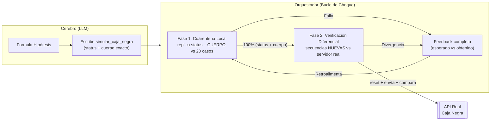

# 🤖 Ingeniería Inversa Autónoma de API "Caja Negra"

Este proyecto implementa un **Agente Científico de Inteligencia Artificial** que hace ingeniería inversa sobre un servidor transaccional cerrado (una "Caja Negra") a partir de evidencia empírica, sin documentación técnica humana.

El objetivo ya **no** es clasificar el status HTTP aislado, sino **replicar el servicio**: para cada payload, predecir el `status` **y el cuerpo exacto** de la respuesta, respetando el estado acumulado de la sesión.

---

## 📌 Contexto del Proyecto

El reto principal radica en vulnerar una API que presenta dos barreras:

1. **Dígito de control opaco:** cada payload termina con un campo de control (ej. `PING;64`, `ALTA;Lucia;82`) cuya aceptación/rechazo hay que deducir de los datos, no de una fórmula heredada.
2. **Reglas de negocio con estado (Stateful):** el resultado de una operación depende del historial (saldos, cuentas creadas con `ALTA`, anulaciones que revierten el estado, límites por operación).

**Objetivo:** la IA debe deducir la lógica interna del servidor, construir un **simulador stateful** que replique respuestas completas con 100% de precisión sobre el dataset empírico, y luego **generalizar** verificándose en vivo contra el servidor real.

---

## ⚙️ Arquitectura: El Bucle de Estimación y Choque

El orquestador principal (`agente_matematico.py`) encierra a la IA en un sandbox iterativo.



### La función que produce la IA

```python
def simular_caja_negra(payload: str) -> dict:
    # Devuelve SIEMPRE {"status": <int>, "body": <cuerpo exacto>}.
    # El estado (cuentas, saldos, contador de operacionId, anulaciones) vive
    # en variables de módulo para reflejar el efecto acumulado de la sesión.
```

El orquestador recarga el módulo desde cero entre sesiones distintas (namespace nuevo = servidor recién reseteado), así que no hace falta un reset manual.

---

## 🔬 Las dos fases

### Fase 1 — Cuarentena local (evidencia: los 20 ejemplos)

- Se le pasan a la IA los 20 casos **con su respuesta completa** (`status` + `response`), en orden, más pistas derivadas automáticamente del propio dataset (pares de contraste, controles confirmados, anulaciones, variantes de mayúsculas).
- La pista de "controles confirmados" distingue **aceptados** (éxito 2xx o error de negocio, que prueba que el control pasó), **rechazados** (`control inválido`) y **no concluyentes** (errores estructurales como aridad o comando desconocido, donde el control pudo no evaluarse). Marcar estos últimos como "control válido" es un veneno silencioso: hacía que el modelo dedujera una aridad equivocada y encadenara fallos (`E401`) en todos los casos posteriores.
- El feedback local incluye un **diagnóstico de causa raíz** que señala el fallo más temprano y detecta la cascada, para evitar que el modelo repita el mismo error raíz intento tras intento.
- Se evalúa comparando **status + cuerpo** con las reglas del reto (claves JSON sin importar orden, arrays ordenados, strings/números idénticos; no-JSON carácter por carácter).
- Si falla, recibe un feedback que muestra el `ESPERADO` y su `MODELO` lado a lado, tanto en éxitos como en errores, y reescribe el código.

### Fase 2 — Verificación diferencial (criterio real de éxito)

- Cuando la IA replica el 100% (status + cuerpo) del dataset, se conecta al **servidor real**.
- Se genera un **corpus de secuencias nuevas** (no presentes en el dataset), ordenado por valor de aprendizaje: primero **barridos de control sobre bases nunca vistas** (para medir si generaliza la validación del control; el barrido recorre *todos* los controles, aunque la réplica diverja, y reporta cuáles acepta el servidor real), luego mutaciones estructurales (comandos desconocidos, aridad inválida, control mal formado, payload vacío), después cada payload desde estado limpio y, por último, el replay de la sesión observada.
- Cada secuencia se ejecuta contra el original (con `POST /__reset`) y contra el simulador de la IA, comparando **respuesta completa paso a paso**.
- Cualquier divergencia vuelve al bucle como evidencia nueva. Éxito = **cero divergencias**.

---

## 🐛 Criterios de diseño y lecciones

1. **La IA debe ver los cuerpos.** Un modelo entrenado solo con status no puede replicar respuestas. El prompt y el validador trabajan ahora con `status` + `response` completos.
2. **Mock stateful, no casos aislados.** Los saldos, contadores y anulaciones dependen del historial; el simulador debe modelar una única sesión con memoria.
3. **ANULA revierte de verdad.** Una operación anulada con éxito debe deshacer su efecto sobre el saldo a partir de ese punto, no solo marcarse.
4. **Sin fórmulas heredadas.** No se inyecta en el prompt ninguna fórmula de control "encontrada antes". El control es opaco: el modelo aprende de los datos qué controles fueron aceptados/rechazados por base y, para bases nuevas, la fase diferencial le devuelve los controles que el servidor real acepta; el objetivo sigue siendo generalizar, no memorizar la lista de payloads.
5. **Verificación diferencial, no auto-confirmación.** Reenviar payloads ya conocidos no prueba nada; el éxito se mide sobre secuencias que el modelo nunca vio.

---

## 🚀 Ejecución

```bash
python3 agente_matematico.py
```

*Nota: las instrucciones originales del reto se preservaron en `RETO_INSTRUCCIONES.md`.*
