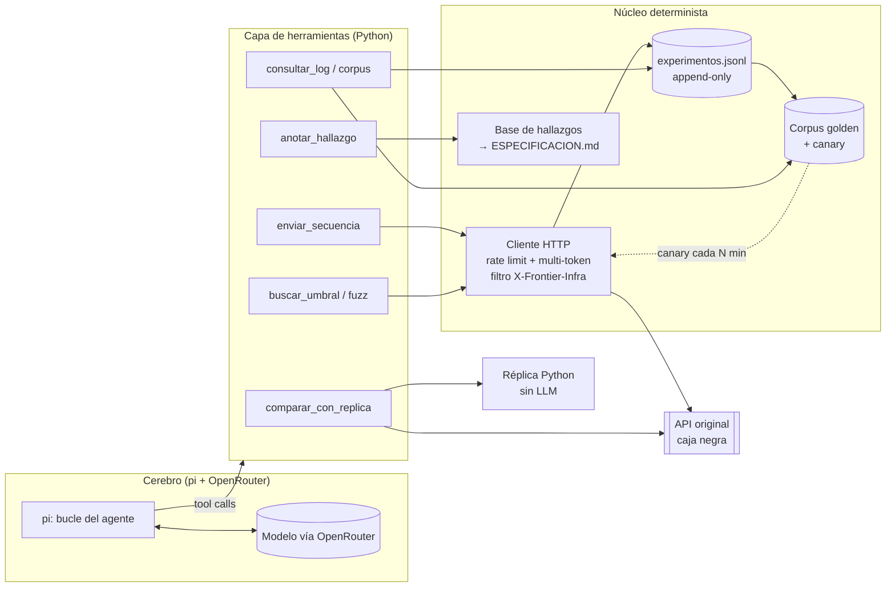

# Arquitectura: agente LLM ↔ API caja negra

## Principio central
**El LLM nunca habla directo con la API.** Habla con un conjunto pequeño de *herramientas* (Python, deterministas). Estas hacen el HTTP, respetan límites, registran todo y devuelven resultados compactos. El LLM decide *qué probar y qué significa*. El código decide *cómo ejecutarlo de forma segura y trazable*.

## Qué ocurre en cada comunicación

| Paso | Quién | Qué hace |
|---|---|---|
| 1 | LLM | Formula una hipótesis: "el control es suma ASCII mod 100". |
| 2 | LLM → herramienta | Llama `enviar_secuencia(hipotesis, [msgs...], reset=True)`. |
| 3 | Cliente | `POST /__reset`, envía cada mensaje en orden, con el token elegido y el rate limit. |
| 4 | Cliente | Descarta y reintenta respuestas con `X-Frontier-Infra: rate-limit`. No entran al log. |
| 5 | Cliente | Escribe una línea por request en `experimentos.jsonl` (`id`, `seq`, `x_req`, `hipotesis`, `request`, `status`, `response`). |
| 6 | Herramienta → LLM | Devuelve un resumen compacto, no el JSON completo, para ahorrar tokens. |
| 7 | LLM | Interpreta, escribe la `conclusion` y registra el hallazgo con su confianza. |
| 8 | Núcleo | Los hallazgos alimentan réplica y spec, cada uno citando los `id` del log. |

## Herramientas que expone al modelo (contrato mínimo)
- `enviar_secuencia(hipotesis, mensajes[], token?)`: reset, envío y log. Devuelve status y cuerpo de cada paso.
- `enviar_crudo(metodo, ruta, headers, cuerpo_bytes, hipotesis)`: para transporte, JSON roto, rutas y métodos raros.
- `buscar_umbral(plantilla, variable, lo, hi)`: búsqueda binaria automática (límite de transferencia, longitudes).
- `probar_checksum(candidatos)`: evalúa funciones candidatas contra todos los pares (mensaje, aceptado/rechazado) del log. Es puro cómputo y no gasta requests.
- `combinar_errores(a, b)`: infiere el orden de evaluación de dos fallos simultáneos.
- `buscar_log(filtro)`: consulta de experimentos previos para no repetir pruebas.
- `comparar_con_replica(secuencia)`: manda la misma secuencia al original y a la réplica local, y devuelve las diferencias.
- `anotar_hallazgo(id, texto, evidencia_ids[], confianza)`: alimenta la spec.
- `estado_presupuesto()`: requests restantes por token y dólares gastados en LLM.

## Qué debe hacer el cliente HTTP (la parte crítica)
1. **Rate limit**: 10 req/s y 8.000/día por token, con contadores persistentes.
2. **Multi-token**: un pool. Cada secuencia usa un token y su estado queda aislado.
3. **Reset obligatorio** antes de toda secuencia, registrado en el log.
4. **Respuesta cruda**: texto exacto, status y bytes. No se normaliza, porque la comparación es carácter por carácter.
5. **Clasificación de respuestas**: servicio, infraestructura (rate limit), timeout o red. Solo las del servicio son evidencia.
6. **Reproducibilidad**: cada request guarda un hash de la versión observada y la hora, para detectar cambios.
7. **Seguridad**: la key de OpenRouter vive solo en el entorno del agente. El cliente nunca la manda a la API.

## Cómo se trata la API cambiante (genérico)
- **Corpus golden**: toda secuencia que dio un resultado queda guardada como caso de regresión.
- **Canary**: cada N minutos se re-ejecuta una muestra pequeña. Si una respuesta difiere, se dispara un evento `CAMBIO_DETECTADO` con la hora y la primera divergencia.
- **Ante un cambio**: el agente aísla qué comportamiento se movió, actualiza el modelo y la sección 6 de la spec. Hace un diff contra la versión previa y no reexplora todo.
- **Perfil por API**: el motor genérico no sabe de `ALTA` ni `TRANSFER`. Esos detalles viven en un perfil intercambiable.

## Control de costos (US$ 45 usables)
- Todo lo mecánico (fuzz, umbrales, checksum, diff) corre en código y no gasta LLM.
- El modelo ve resúmenes y no logs enteros.
- Un modelo barato para exploración y uno fuerte solo para redactar la spec.
- Un contador de gasto por llamada que frena al llegar a un tope diario.
- Los US$ 5 de reserva no se tocan.

## Dos lazos de trabajo
1. **Lazo de exploración (LLM + herramientas)**: hipótesis → experimento → conclusión → hallazgo.
2. **Lazo de verificación (sin LLM)**: réplica ↔ original con un fuzzer grande. Cada discrepancia vuelve al lazo 1 como nueva hipótesis.

El trabajo termina cuando el fuzz diferencial no encuentra divergencias y la spec cita evidencia para todo.

## Decisiones abiertas
1. ¿`pi` permite registrar herramientas propias (por MCP, scripts o extensiones), o solo ejecuta comandos de shell? Esto decide cómo se conectan las herramientas.
2. ¿Qué modelos de OpenRouter se usarán para cada rol?
3. ¿Cuántos tokens tiene el equipo?
