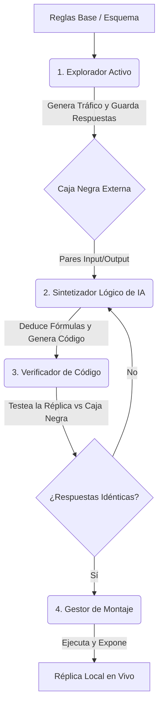

# Arquitectura Generativa End-to-End para Réplicas de Servicios

Con base en la visión de un sistema más directo y proactivo, esta arquitectura describe un **Pipeline Autónomo** que no solo monitorea, sino que es capaz de "ir al servicio, entenderlo, programar su propia versión y levantarla" de principio a fin, basándose en un conjunto inicial de reglas base.

## 1. El Concepto Principal: De la Exploración al Despliegue

En lugar de construir una réplica estática que luego parcheamos, construiremos un **Agente Orquestador** que funciona como un ingeniero de software inverso automatizado. Le daremos el formato básico de los comandos, y él se encargará de extraer la lógica matemática oculta y de crear un clon funcional instantáneo.

## 2. Los 4 Módulos del Sistema

### Módulo 1: Explorador Activo (El Mapeador)
Toma las "reglas definidas" iniciales (ej. qué comandos existen, longitud máxima, tipos de datos) y bombardea el servicio `X` estratégicamente para mapear el terreno.
- **Entrada:** Plantillas de comandos (ej. `CONSULTA;{alfanumérico}`).
- **Acción:** Hace un barrido (fuzzing) probando diferentes combinaciones para ver qué genera errores (`E201`, `E104`) y qué genera éxitos.
- **Salida:** Un dataset de entrenamiento exacto: Entradas -> Respuestas de la Caja Negra.

### Módulo 2: Sintetizador Lógico (El Cerebro)
Un agente LLM avanzado cuyo único trabajo es actuar como ingeniero inverso y programador.
- **Entrada:** El dataset generado por el Explorador.
- **Acción:** Descubre el patrón (ej. "Ah, esto es un hash de Horner base 10 con módulo 97") y **escribe un archivo de servidor web completo** (ej. en FastAPI/Flask) que implemente exactamente esa lógica.
- **Salida:** Código fuente de la réplica local (`app_generada.py`).

### Módulo 3: Verificador en Sandbox (El Tester)
Antes de montar el servicio para el público, debemos estar seguros de que el LLM no alucinó.
- **Acción:** Levanta la `app_generada.py` en un puerto temporal (sandbox). Luego, toma el dataset del Módulo 1 y le dispara a la nueva app.
- **Bucle de Feedback:** Si la app generada da un resultado distinto a la Caja Negra, el Verificador le envía el error al Sintetizador para que reescriba el código. Este bucle se repite hasta alcanzar 100% de paridad.

### Módulo 4: Gestor de Montaje (El Desplegador)
Una vez que el Verificador da luz verde, el sistema toma el control.
- **Acción:** Mata cualquier réplica anterior que estuviera corriendo, mueve `app_generada.py` a producción local, e inicia el servicio en el puerto definitivo.
- **Resultado:** En cuestión de minutos, el sistema analizó un servicio desconocido y levantó un clon exacto, listo para recibir tráfico real.

## 3. ¿Cómo Maneja el Cambio Futuro?

Este pipeline es iterativo. Si en el futuro tenemos que conectarnos a un nuevo servicio, o si el servicio `X` cambia de un día para otro, simplemente **volvemos a ejecutar el Pipeline desde el Módulo 1**. El sistema irá al servicio cambiado, descubrirá las nuevas reglas (Módulo 2), reescribirá el código del clon, lo probará (Módulo 3) y reemplazará el servicio actual sin intervención humana (Módulo 4).

## 4. Plan de Implementación Inmediato

Para materializar esto hoy, crearemos el **Orquestador (Pipeline Script)** que una las piezas:

1. **Definir las Reglas Base:** Crear un archivo YAML/JSON (`esquema.yml`) que el orquestador leerá para saber a dónde ir y qué formato básico probar.
2. **Construir el Explorador:** Un script Python que lea el esquema, contacte a la API (usando nuestra infraestructura de rate-limit) y guarde un `.jsonl`.
3. **Prompting del Sintetizador:** Preparar el código que enviará el `.jsonl` al LLM y extraerá el código Python generado.
4. **Script de Montaje:** Un programa maestro que orqueste estos pasos y al final ejecute `subprocess.Popen(["python", "app_generada.py"])`.
